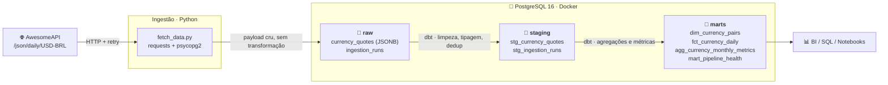

# 💱 Currency Data Pipeline — Python + PostgreSQL + dbt

Pipeline de dados **end-to-end** que coleta cotações de moedas de uma API pública,
armazena o dado bruto em um PostgreSQL containerizado e o transforma em métricas de
negócio com **dbt**, seguindo a **Arquitetura Medallion** (Bronze → Silver → Gold).

[](https://github.com/daniloofrs/data-pipeline-dbt/actions/workflows/ci.yml)


---

## 📌 O que este projeto entrega

| | |
|---|---|
| **Fonte** | [AwesomeAPI Economia](https://docs.awesomeapi.com.br/api-de-moedas) — cotações de câmbio, pública e gratuita |
| **Ingestão** | Script Python idempotente, com *retry*, *backoff* e log de auditoria |
| **Armazenamento** | PostgreSQL 16 em Docker, com volume nomeado (dados persistem entre reinícios) |
| **Transformação** | dbt-postgres, 6 modelos em 2 camadas + 1 macro + 1 teste genérico customizado |
| **Qualidade** | **71 testes** automatizados (`unique`, `not_null`, `accepted_values`, `relationships`, `positive_value`) |
| **Observabilidade** | Tabela de execuções + mart de saúde do pipeline |
| **Metodologia** | Arquitetura Medalhão concebida pelo autor e implementada com suporte de **Claude Code** (AI Pair Programming) |

---

## 🏗️ Arquitetura



### A responsabilidade de cada camada

| Camada | Schema | Materialização | Responsabilidade |
|---|---|---|---|
| 🥉 **Bronze** | `raw` | Tabela (append-only) | Preservar o dado **exatamente** como a API entregou (JSONB) + linhagem (`batch_id`, `ingested_at`). Nenhuma regra de negócio aqui. |
| 🥈 **Silver** | `staging` | View | Extrair campos do JSON, converter tipos (`numeric`, `timestamptz`), descartar registros inválidos e **remover duplicatas**. |
| 🥇 **Gold** | `marts` | Tabela | Modelagem dimensional e métricas prontas para consumo: variação diária, médias móveis, volatilidade e consolidação mensal. |

> **Por que o Bronze guarda JSONB?** Se a API mudar um campo ou uma regra de negócio for
> revista, o histórico cru continua intacto — basta reprocessar o dbt, sem recoletar nada.

---

## 🚀 Como rodar

### Pré-requisitos
Docker + Docker Compose e Python 3.11+.

### 1. Clonar e configurar

```bash
git clone https://github.com/<seu-usuario>/data-pipeline-dbt.git
cd data-pipeline-dbt
cp .env.example .env
```

### 2. Criar o ambiente Python

```bash
python -m venv venv
source venv/Scripts/activate      # Windows (Git Bash) — Linux/macOS: source venv/bin/activate
pip install -r requirements.txt
```

### 3. Subir o banco de dados

```bash
docker compose up -d
```

O container `dw_postgres` já nasce com os schemas `raw`, `staging` e `marts` criados.
O **Adminer** (UI web do banco) fica disponível em <http://localhost:8080>
— servidor `postgres`, usuário `dbt_user`, senha `dbt_password`.

### 4. Ingerir os dados (Bronze)

```bash
python ingestion/fetch_data.py
```

Parâmetros opcionais (sobrescrevem o `.env`):

```bash
python ingestion/fetch_data.py --pairs USD-BRL,EUR-BRL --days 90
```

```
2026-09-15 21:00:45 | INFO | Batch 5021888a… | pares=USD-BRL,EUR-BRL,GBP-BRL,BTC-BRL | dias=180
2026-09-15 21:00:45 | INFO | Camada Bronze pronta (schema raw).
2026-09-15 21:00:46 | INFO | USD-BRL    ->  180 cotacoes gravadas em raw.currency_quotes
2026-09-15 21:00:46 | INFO | EUR-BRL    ->  180 cotacoes gravadas em raw.currency_quotes
2026-09-15 21:00:47 | INFO | GBP-BRL    ->  180 cotacoes gravadas em raw.currency_quotes
2026-09-15 21:00:47 | INFO | BTC-BRL    ->  180 cotacoes gravadas em raw.currency_quotes
2026-09-15 21:00:47 | INFO | Ingestao concluida: 720 linhas no batch 5021888a…
```

### 5. Transformar e testar (Silver + Gold)

```bash
cd dbt
dbt build --profiles-dir .      # roda os modelos E os testes, na ordem do DAG
```

```
Done. PASS=71 WARN=0 ERROR=0 SKIP=0 TOTAL=71
```

### 6. Explorar a documentação gerada

A porta 8081 é usada de propósito: a 8080 já está ocupada pelo Adminer.

```bash
dbt docs generate --profiles-dir .
dbt docs serve --profiles-dir . --port 8081   # catálogo e DAG em http://localhost:8081
```

---

## 🧰 Comandos úteis do dia a dia

```bash
# Rodar somente uma camada
dbt run --profiles-dir . --select staging
dbt run --profiles-dir . --select marts

# Rodar um modelo e tudo que depende dele
dbt build --profiles-dir . --select stg_currency_quotes+

# Só os testes
dbt test --profiles-dir .

# Verificar se a fonte está atualizada (freshness)
dbt source freshness --profiles-dir .

# Ver o SQL final que o dbt gera
dbt compile --profiles-dir . --select fct_currency_daily

# Derrubar os containers preservando os dados
docker compose down

# Derrubar e APAGAR o volume de dados
docker compose down -v
```

---

## 📂 Estrutura do projeto

```
data-pipeline-dbt/
├── docker-compose.yml              # PostgreSQL 16 persistente + Adminer
├── docker/postgres/init/
│   └── 01_schemas.sql              # Cria raw / staging / marts na 1ª inicialização
├── ingestion/
│   └── fetch_data.py               # 🥉 Bronze: API → PostgreSQL (JSONB)
├── dbt/
│   ├── dbt_project.yml             # Materializações e schemas por camada
│   ├── profiles.yml                # Conexão via env_var (nenhum segredo no repo)
│   ├── macros/
│   │   ├── generate_schema_name.sql    # Schemas limpos, sem prefixo
│   │   └── generate_surrogate_key.sql  # Surrogate key sem depender do dbt_utils
│   ├── tests/generic/
│   │   └── positive_value.sql          # Teste genérico customizado
│   └── models/
│       ├── staging/                # 🥈 Silver
│       │   ├── _sources.yml
│       │   ├── _staging__models.yml
│       │   ├── stg_currency_quotes.sql
│       │   └── stg_ingestion_runs.sql
│       └── marts/                  # 🥇 Gold
│           ├── _marts__models.yml
│           ├── dim_currency_pairs.sql
│           ├── fct_currency_daily.sql
│           ├── agg_currency_monthly_metrics.sql
│           └── mart_pipeline_health.sql
├── requirements.txt
└── .env.example
```

---

## 🧱 Modelos de dados

### 🥈 Silver — `staging`

| Modelo | Grão | O que resolve |
|---|---|---|
| `stg_currency_quotes` | par + instante da cotação | Extrai 11 campos do JSONB, converte `epoch → timestamp` e strings → `numeric`, descarta cotações sem preço ou sem timestamp, e deduplica com `row_number()` mantendo a ingestão mais recente. |
| `stg_ingestion_runs` | execução | Normaliza o log de ingestão e calcula a duração de cada execução. |

### 🥇 Gold — `marts`

| Modelo | Grão | Métricas |
|---|---|---|
| `dim_currency_pairs` | par de moedas | Moeda base/cotação, período coberto, total de cotações, flag `is_active`. |
| `fct_currency_daily` | par + dia | Fechamento, máxima, mínima, *spread*, amplitude intradiária, variação absoluta e percentual vs. dia anterior, **médias móveis de 7 e 30 dias**, **volatilidade móvel**, tendência (`ALTA`/`BAIXA`/`ESTÁVEL`) e recorde histórico. |
| `agg_currency_monthly_metrics` | par + mês | Abertura e fechamento do mês, média, amplitude, **volatilidade absoluta e relativa** (comparável entre BTC e USD), dias de alta vs. baixa e classificação do mês. |
| `mart_pipeline_health` | dia | Execuções, taxa de sucesso, volume ingerido e duração média — observabilidade do próprio pipeline. |

---

## ✅ Qualidade de dados

São **71 testes** executados a cada `dbt build`:

| Teste | Onde é aplicado |
|---|---|
| `unique` | Chaves substitutas e naturais de todas as camadas (`quote_key`, `daily_quote_key`, `monthly_metrics_key`, `currency_pair`…) |
| `not_null` | Todas as colunas de chave, data e métrica obrigatória |
| `accepted_values` | `run_status`, `daily_trend`, `month_trend` |
| `relationships` | Integridade referencial entre os fatos e `dim_currency_pairs` |
| `positive_value` | **Teste genérico customizado** — preço de câmbio ≤ 0 é sempre erro de dado |
| `source freshness` | Alerta se a camada Bronze não recebe carga há 48h; erro após 7 dias |

### A deduplicação funcionando na prática

Cada execução da ingestão re-coleta dias que já estão no banco — de propósito, porque
o Bronze é *append-only*. É a camada Silver que garante o grão único:

| | Linhas | O que aconteceu |
|---|---|---|
| 🥉 `raw.currency_quotes` | **840** | 2 execuções, com sobreposição de período |
| 🥈 `stg_currency_quotes` | **723** | 117 duplicatas exatas removidas |
| 🥇 `fct_currency_daily` | **714** | Cotações intradiárias consolidadas no fechamento do dia |

O resultado: rodar a ingestão 1 ou 10 vezes produz **exatamente o mesmo dado no Gold**.

---

## 🔍 Exemplos de consulta

```sql
-- Como cada moeda se comportou nos últimos meses
SELECT currency_pair, year_month, month_open_price, month_close_price,
       month_change_pct, volatility_pct, month_trend
FROM marts.agg_currency_monthly_metrics
WHERE currency_pair = 'USD-BRL'
ORDER BY month_start_date DESC;
```

```
 currency_pair | year_month | month_open | month_close | change_pct | volatility_pct |  month_trend
---------------+------------+------------+-------------+------------+----------------+----------------
 USD-BRL       | 2026-09    |   5.153900 |    5.152900 |    -0.0194 |         0.4632 | DESVALORIZACAO
 USD-BRL       | 2026-08    |   5.078900 |    5.183700 |     2.0634 |         0.8385 | VALORIZACAO
 USD-BRL       | 2026-07    |   5.220600 |    5.073600 |    -2.8158 |         0.8302 | DESVALORIZACAO
```

```sql
-- Os 5 dias de maior volatilidade do dólar no período
SELECT quote_date, close_bid_price, daily_change_pct, volatility_7d, daily_trend
FROM marts.fct_currency_daily
WHERE currency_pair = 'USD-BRL'
ORDER BY volatility_7d DESC
LIMIT 5;
```

```sql
-- O preço fechou acima ou abaixo da média móvel de 30 dias?
SELECT currency_pair, quote_date, close_bid_price, moving_avg_30d,
       ROUND((close_bid_price - moving_avg_30d) / moving_avg_30d * 100, 2) AS desvio_pct
FROM marts.fct_currency_daily
WHERE quote_date = (SELECT MAX(quote_date) FROM marts.fct_currency_daily);
```

```sql
-- O pipeline rodou hoje e trouxe dado?
SELECT * FROM marts.mart_pipeline_health ORDER BY run_date DESC;
```

---

## 🤖 Metodologia & Engenharia Assistida por IA

Este repositório foi desenvolvido sob a abordagem de **AI Pair Programming / Engenharia Acelerada por IA** com o **Claude Code (Anthropic)**:

* **Arquitetura & Requisitos (Danilo Fernandes):** Concepção da modelagem dimensional Medalhão (Bronze → Silver → Gold), desenho do fluxo de ingestão, definição das regras de negócio de câmbio e especificação dos critérios de aceitação para validação dos dados.
* **Aceleração via IA:** Geração assistida do boilerplate dos modelos SQL/Jinja no dbt, estruturação exaustiva dos 71 testes no schema.yml e orquestração dos contêineres Docker Compose.
* **Governança Técnica:** Revisão minuciosa de cada camada, validação prática no terminal e execução de testes de integridade localmente.

---

## 🎯 Decisões técnicas

- **Bronze em JSONB, não em colunas tipadas** — a ingestão não faz suposições sobre o
  schema da fonte. Se a API adicionar um campo, o dado já está no banco: basta ajustar o
  Silver e reprocessar.
- **Silver como *view*, Gold como *table*** — o Silver é lógica de limpeza (custo baixo,
  sempre atualizado); o Gold é consumido por dashboards e compensa materializar.
- **Idempotência garantida pela transformação, não pela ingestão** — a ingestão só
  acrescenta; a deduplicação vive no dbt, onde é testável e versionada.
- **Surrogate keys via macro própria** — evita a dependência do `dbt_utils`, então o
  projeto roda com `dbt build` puro, sem precisar de `dbt deps`.
- **Credenciais só via `env_var`** — o `profiles.yml` é versionável porque não contém
  nenhum segredo; o `.env` está no `.gitignore`.
- **Fuso horário explícito (`America/Sao_Paulo`)** — a data de negócio de uma cotação
  não pode depender do fuso do servidor que roda o pipeline.

---

## 🛣️ Próximos passos

- [ ] Orquestração com Airflow ou Dagster (agendamento diário)
- [ ] Materialização incremental no `fct_currency_daily` para históricos longos
- [ ] Snapshots dbt para rastrear mudanças na dimensão (SCD Type 2)
- [ ] Dashboard no Metabase/Streamlit lendo a camada Gold
- [ ] CI no GitHub Actions rodando `dbt build` contra um Postgres de serviço

---

## 🧯 Solução de problemas

| Problema | Solução |
|---|---|
| `Bind for 0.0.0.0:5432 failed: port is already allocated` | Já existe um Postgres local na porta 5432. Altere `POSTGRES_PORT` no `.env` (o projeto já vem configurado com **5433**) e rode `docker compose up -d` novamente. |
| `Falha ao conectar no Postgres` na ingestão | O banco ainda está subindo. Verifique com `docker compose ps` — a coluna de status deve indicar `healthy`. |
| `Database Error ... schema "raw" does not exist` no dbt | Rode a ingestão antes do dbt: é ela que cria e popula a camada Bronze. |
| Schemas `raw`/`staging`/`marts` não existem | O script de init só roda na criação do volume. Recrie com `docker compose down -v && docker compose up -d`. |

---

## 📄 Licença

MIT — sinta-se livre para usar como base para o seu próprio portfólio.
